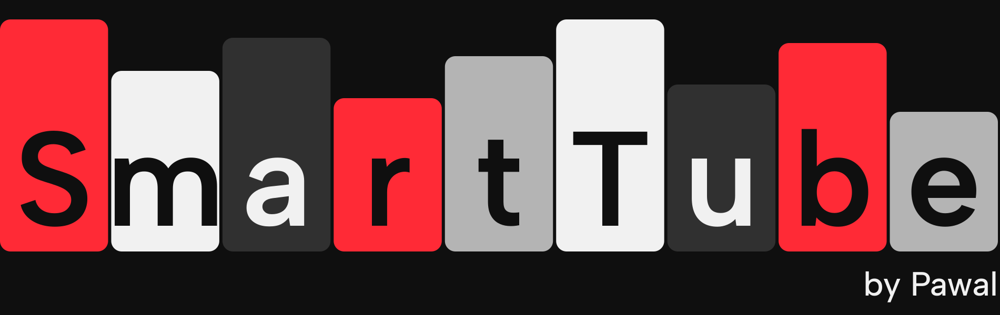
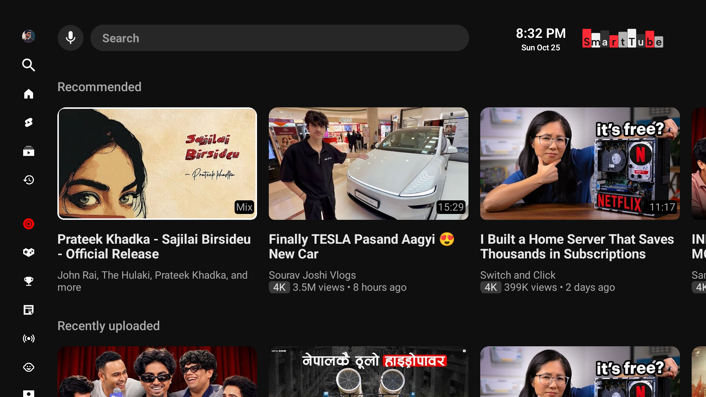
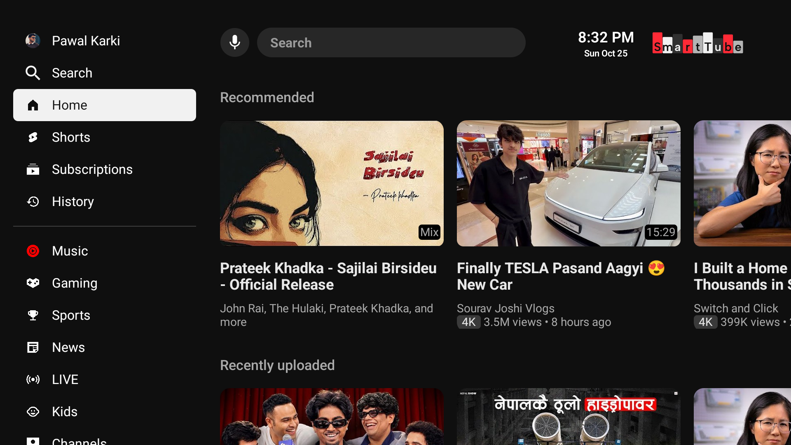

<p align="center"></p>

A free, open-source media client for Android TV and TV boxes, with a YouTube TV style interface, tuned for slow hardware.

**[Website](https://smarttube-tv.vercel.app)** · **[Download the APK](https://github.com/pawal-karki/SmartTube/releases/latest)** · [Original project](https://github.com/yuliskov/SmartTube)



## What's different

**Interface**
- Sidebar collapses to an icon rail and expands with labels and a white selection pill
- Top bar with mic and search pill that follows the sidebar, hidden when the page is scrolled down
- Borderless cards with rounded 16:9 thumbnails, white focus ring, no zoom or shadow
- Round channel cards with avatar, name, handle and subscribers
- Grey chips for `4K` and `Auto-dubbed` before the views line
- Skeleton rows while a section, search or channel page loads, instead of a spinner
- Smaller sidebar icons, red Music icon, reordered settings tiles with lighter icons
- Roboto font and an in-app on-screen keyboard for search, with a suggestions column
- Clean player: clock, quality info, remaining time and likes stay off until you turn them on in settings



**Playback and speed**
- Player engine warms up 1.5 s after launch (was 10 s)
- Playback info is prefetched once you stop on a card, so opening it starts faster
- Default quality capped at 1080p for a faster start
- Suggestions load after the player is ready, 1.5 s start buffer
- Smoother sidebar animation, and pages are built only once focus settles on them

**Branding**
- The `stbeta` build is named SmartTube, with its own icon, TV banner and logo (it no longer uses YouTube's)

## Install

1. Download a file from the [latest release](https://github.com/pawal-karki/SmartTube/releases/latest):

   | File | Use it for |
   | --- | --- |
   | `armeabi-v7a` | Most TVs and boxes, even ones with 64-bit chips |
   | `arm64-v8a` | 64-bit devices. If it will not install with "no matching ABIs", use the one above |
   | `universal` | Not sure. About 40 MB, works on both |

2. Copy it to the TV with a USB stick, or type the link into the Downloader app.
3. Open it from a file manager and allow installs from unknown sources when asked.

More help is on the [website](https://smarttube-tv.vercel.app/#sideload).

## Build

Requires JDK 17 and the Android SDK.

```bash
git clone --recurse-submodules https://github.com/pawal-karki/SmartTube.git
cd SmartTube
export JAVA_HOME=/path/to/jdk17
sh ./gradlew :smarttubetv:assembleStbetaRelease
```

APKs are written to `smarttubetv/build/outputs/apk/stbeta/release/`.

Release builds are signed with the debug key so they install over a debug build. Replace the signing config in `smarttubetv/build.gradle` before distributing.

`patches/` holds changes for the `MediaServiceCore` submodule. Apply them inside the submodule.

The landing page lives in [`website/`](website) (static HTML, deployed on Vercel).

## License

[MIT](LICENSE), same as upstream. Based on [yuliskov/SmartTube](https://github.com/yuliskov/SmartTube); see it for the FAQ, supported devices and installation help. Video thumbnails in the screenshots belong to their channels.
